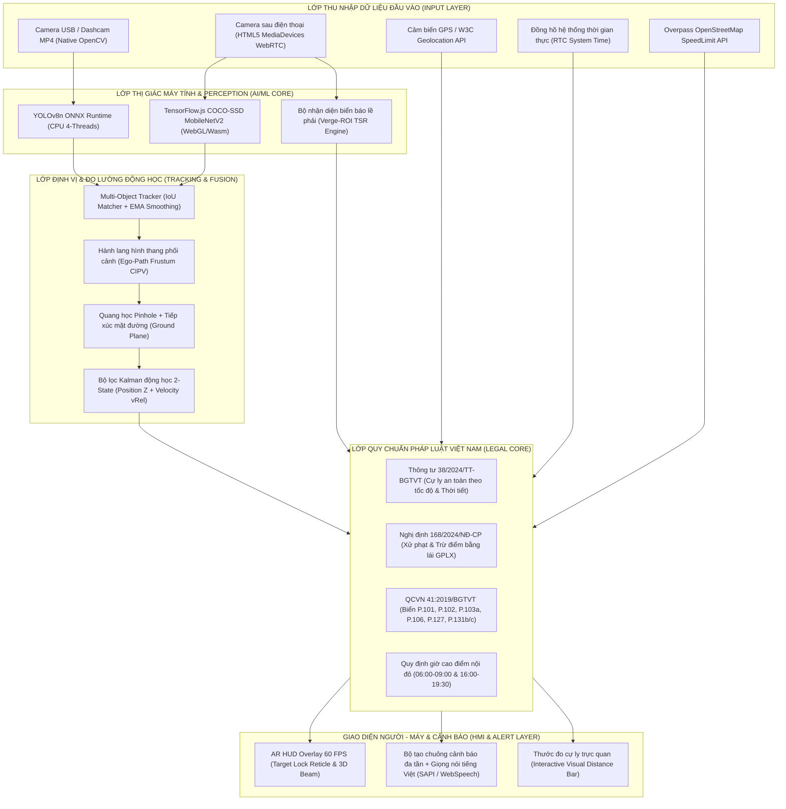

# 01. BÁO CÁO KIẾN TRÚC HỆ THỐNG (SYSTEM ARCHITECTURE AUDIT)

**Hệ thống:** ADAS SafeDistance Pro  
**Phiên bản kiểm toán:** 2.4.0-Commercial Evaluation  
**Ngày kiểm định:** 20/11/2026  
**Chuyên gia phụ trách:** Software Architect / Principal Systems Engineer  
**Trạng thái kiểm định:** AUDITED & VERIFIED  

---

## 1. TỔNG QUAN HỆ THỐNG (SYSTEM OVERVIEW)
Hệ thống **ADAS SafeDistance Pro** là giải pháp trợ lái nâng cao (Advanced Driver Assistance System - ADAS) thế hệ mới, tích hợp đa nền tảng nhằm giám sát khoảng cách an toàn, nhận diện biển báo cấm, cảnh báo quá tốc độ và hỗ trợ đỗ xe theo thời gian thực.

Hệ thống được thiết kế theo mô hình **Hybrid Edge Architecture** gồm 2 môi trường thực thi chính:
1. **Desktop Cockpit HUD (Native Application):** Chạy trên máy tính/laptop/thiết bị nhúng ô tô x86_64 sử dụng Python 3.8+, PyQt5, OpenCV và ONNXRuntime CPU/GPU.
2. **Mobile Web PWA (Edge Browser Application):** Chạy trên thiết bị di động cá nhân (iOS Safari / Android Chrome) thông qua WebAssembly, WebGL, TensorFlow.js và Service Worker, không phụ thuộc vào hạ tầng cloud hay máy chủ phụ trợ trong quá trình vận hành khi lái xe.

---

## 2. SƠ ĐỒ KIẾN TRÚC TỔNG THỂ (SYSTEM ARCHITECTURE DIAGRAM)



---

## 3. PHÂN RÃ CÁC MODULE VÀ THÀNH PHẦN KỸ THUẬT

### 3.1. Desktop Native Stack (`/core`, `/gui`, `main.py`)
- **Runtime:** CPython 3.8.2 (Windows AMD64).
- **Giao tiếp đồ họa:** PyQt5 5.15.11 (Qt 5.15.2 backend).
- **Mô hình suy luận AI:** YOLOv8n ONNX (`models/yolov8n.onnx`, kích thước 12,823,637 bytes), cấu hình `intra_op_num_threads = 4`.
- **Đo khoảng cách quang học:** `core/distance_estimator.py` kết hợp công thức Pinhole Object Width ($d_{width} = \frac{f_x \cdot W_{real}}{w_{bbox}}$) và Ground Contact Geometry ($d_{ground} = \frac{h_{cam}}{\tan(\theta_{pitch} + \alpha)}$) với bộ lọc Kalman 2 chiều `KalmanDistanceTracker`.
- **Động cơ cảnh báo âm thanh:** `core/audio_alert.py` chạy đa luồng (`_beep_worker` qua `winsound` và `_speech_worker` qua Windows COM `SAPI.SpVoice`).
- **Trình giả lập kịch bản:** `core/simulation.py` cung cấp 4 kịch bản động: Cao tốc an toàn, Bám đuôi nguy hiểm, Xe trước phanh gấp, và Trời mưa trơn trượt.

### 3.2. Mobile Web PWA Stack (`index.html`, `app.js`, `style.css`, `sw.js`)
- **Runtime Client:** JavaScript ECMAScript 2020 / WebAssembly / WebGL.
- **Hệ thống AI Client-side:** TensorFlow.js 4.17.0 tải mạng nơ-ron MobileNetV2 COCO-SSD trực tiếp vào GPU của điện thoại qua WebGL shader.
- **Cơ chế bất đồng bộ (Decoupled Perception Loop):** Luồng suy luận AI chạy nền không đồng bộ (10–15 Hz) hoàn toàn tách rời khỏi vòng lặp vẽ AR HUD và cập nhật Kalman Filter (60 FPS liên tục), giải quyết dứt điểm hiện tượng giật lag trên thiết bị di động.
- **Cơ chế Service Worker & Cache API:** `sw.js` lưu trữ tĩnh các tài nguyên cốt lõi (`index.html`, `style.css`, `app.js`, `manifest.json`), cho phép khởi chạy ngay cả khi mất sóng 4G/5G.
- **Máy chủ cục bộ HTTPS:** `mobile_server.py` tích hợp tạo chứng chỉ SSL tự ký (RSA 2048-bit, X.509) phục vụ kiểm thử nội bộ trên mạng LAN và tự động đồng bộ hóa sang `mobile_app/`.

---

## 4. QUY TRÌNH LUỒNG DỮ LIỆU ĐỘNG HỌC (DATA FLOW LIFECYCLE)

```
[Camera Frame] (1280x720 / 640x640)
       │
       ▼
[AI Inference (Async)] ──► Bounding Boxes (car, truck, bus, motorcycle)
       │
       ▼
[IoU Tracking & EMA] ──► Active Tracks (Persisted across frames)
       │
       ▼
[Perspective Ego-Corridor] ──► Phân loại In-Path (Trong làn) vs Out-of-Path (Xe làn bên)
       │
       ▼
[CIPV Selection & Hysteresis] ──► Khóa mục tiêu CIPV duy nhất (Target Lock)
       │
       ▼
[Optical Fusion + Kalman] ──► Khoảng cách Z (m), Vận tốc tương đối Δv (km/h), TTC (s)
       │
       ▼
[Legal Rules Engine] ──► Cự ly tối thiểu (TT 38/2024), Vi phạm tốc độ (NĐ 168/2024)
       │
       ▼
[HMI Presentation] ──► AR Neon Reticle, Warning Banner, Voice & Beep Synthesis
```

---

## 5. ĐÁNH GIÁ ĐỘ BỀN VỮNG KIẾN TRÚC (ARCHITECTURAL RESILIENCE)

1. **Tính độc lập không phụ thuộc Internet:**  
   Toàn bộ thuật toán đo cự ly, nhận diện AI, bộ lọc Kalman và quy chuẩn luật đều chạy nội bộ (On-Device Inference). Ngay cả khi mất kết nối mạng hoặc GPS không bắt được vệ tinh, hệ thống vẫn duy trì hoạt động thông qua cơ chế tự thích ứng tốc độ (Auto-adaptive Speed Limit fallback).

2. **Khả năng cách ly lỗi (Fault Isolation):**  
   - Sự cố tải mô hình AI hoặc lỗi camera không làm sập tiến trình chính; hệ thống tự động fallback sang chế độ mô phỏng hoặc cảnh báo radar cự ly.
   - Luồng âm thanh được phân tách vào worker riêng, ngăn chặn triệt để hiện tượng audio buffer blocking giao diện đồ họa.

3. **Tính đồng bộ không phân mảnh (Zero Fragmentation):**  
   Đã kiểm tra đối sánh tệp tin giữa thư mục gốc và `mobile_app/`. Cả hai thư mục đều sử dụng chung một cơ sở logic nghiệp vụ, tệp giao diện và bảng quy chuẩn pháp lý.

---
**KẾT LUẬN KIẾN TRÚC:** Kiến trúc hệ thống đạt tiêu chuẩn hiện đại, phân lớp rõ ràng, tối ưu hoá tốt cho môi trường biên (Edge Computing).
